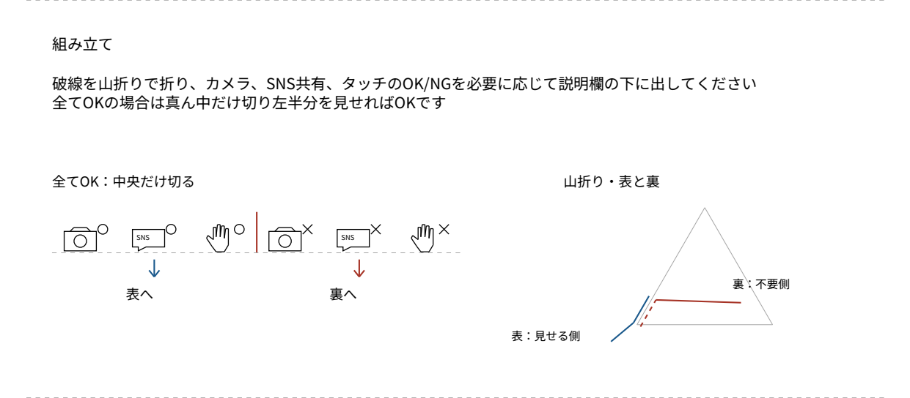

# CSVから作るイベント名札

CSVから作品紹介とX投稿用QRを入れた名札を作成するツールです。従来の画像テンプレートによるA4二面出力を残し、卓上三角カードと首掛け八面名札を選べるようにしました。入力はローカルCSVと任意のローカル画像だけです。申込システム・アカウント・認証・ネット通信・投稿処理は含みません。

## インストール

Python 3.10以降を使います。仮想環境を作り、その環境のPythonでインストールしてください。

```sh
python -m venv .venv
# Windows: .venv\Scripts\activate
# macOS/Linux: source .venv/bin/activate
python -m pip install -r requirements.txt
```

Pillow・qrcode・ReportLabを使います。日本語TTFは同梱のNoto Sans JPを埋め込むため、Windows固有のフォントパスは新テンプレートでは不要です。`--font path/to/font.ttf` で別の日本語TrueTypeフォントも指定できます。

## 新テンプレート

```sh
# 卓上：1人につきA4縦1枚
python generate_name_plates.py --template tent --csv samples/fictional.csv --output generated/tent.pdf

# 首掛け：参加人数分を自動で並べるA4八面
python generate_name_plates.py --template badges --csv samples/fictional.csv --output generated/badges.pdf

# ハッシュタグ・PDF文書名をイベントに合わせる
python generate_name_plates.py --template tent --csv samples/fictional.csv --output generated/tent.pdf --hashtag 展示イベント --event-name 展示イベント
```

`python event_cards.py` からも同じ引数で利用できます。`--help` で引数を確認できます。出力先は明示指定です。印刷は **A4縦・片面・100%** にしてください。

### 卓上三角カード

上から選択帯21mm、白い底面92mm、組立説明92mm、正面紹介92mm。3辺92mmの正三角形に折ります。3本の横破線は印刷面から見て山折りです。

選択帯は左からカメラ○・SNS○・手○・カメラ×・SNS×・手×。全OK/全NGなら中央の1本だけ、混在なら表/裏が切り替わる境界だけ、紙端から選択帯下の破線まで切ります。必要側を正面下の余白へ出し、不要側を紹介紙の裏へ差し込みます。紙は根元でつながったままで、テープを使う前提は置いていません。

配布紙は以下の2文と短い図で説明します。

> 破線を山折りで折り、カメラ、SNS共有、タッチのOK/NGを必要に応じて説明欄の下に出してください
> 全てOKの場合は真ん中だけ切り左半分を見せればOKです



作品画像は縦横比を保ち、JPEGの回転情報を反映してからメタデータを除去します。未対応文字・画像エラー・文字の収まり不足は黙って省略せず中断します。新テンプレートは名前30文字、作品名100文字、作品説明100文字以内です。文字・QR・アイコンはベクター、QRは55mm角・quiet zone 4モジュール・誤り訂正M・最小モジュール0.3mmです。

### 首掛け名札

紙の四周6mmを空け、その内側を2列×4行に分けます。1枚99×71.25mmで、出展者名と場所だけを大きく載せます。破線で切り取ってください。余白を考慮したA4八等分相当で、無余白の105×74.25mmではありません。

参加人数が入っている行は、その人数分を自動出力します。未入力は確認済みの1人に補完しません。人数をCSVへ入力するか、未入力行に限って使う枚数を明示してください。

```sh
python generate_name_plates.py --template badges --csv my-list.csv --output generated/badges.pdf --default-count 2
```

この例でも既知の参加人数は変えず、未入力行にだけ2枚を割り当てます。1回合計1000枚まで出力できます。参加人数そのものの保存上限ではありません。写真・作品説明・QRは首掛けには載せません。

実紙の差し込み保持力・ロック強度と、個別の首掛けホルダーへの適合は未検証です。

## CSV

UTF-8（BOM付きも可）で、既存の **`name,作品,作品説明,x`** を維持しています。新テンプレートで次の任意列を追加できます。

| 列 | 内容 |
| --- | --- |
| `name` | 出展者名 |
| `作品` | 作品名。首掛けでは空欄可 |
| `作品説明` | 作品紹介文。空欄可 |
| `x` | `https://x.com/handle`、`@handle`、または空欄 |
| `場所` | 区画・席の文字列。日ごとに違う場合は `10/24 A-1a / 10/25 B-2` のように対応を含める |
| `日付` | 任意。場所の前へ表示する文字列。仮の日付を自動生成しない |
| `画像` | CSVからの相対パス、またはローカルの絶対パス。PNG/JPEG/WebP、5MB・4000万画素以内。HTTPやネットワーク共有パスは不可 |
| `参加人数` | 正の安全な整数。別名 `participantCount` も可。椅子数や日数とは独立 |

`場所` がなければ「未割当」です。CSV自体は書き換えません。架空の具体例は [samples/fictional.csv](samples/fictional.csv) を参照してください。実データをリポジトリへ追加しないでください。

## X投稿用QR

行先は `https://twitter.com/intent/tweet` です。`text` へ `作品名(出展者名)  #ハッシュタグ` をURLエンコードして入れます。標準ハッシュタグは従来どおり `つくろがや` で、`--hashtag` で変更できます。

X登録済みなら `url` 引数に作者の `https://x.com/handle` を入れます。X未入力・アカウント名のないXトップURLは `url` を省略します。個別紹介ページのURLは追加しません。QR作成時にXへ通信したり、実際の投稿を実行したりすることはありません。

## 従来の使い方

無引数の `python generate_name_plates.py` は、これまでどおりカレントフォルダの `name_list.csv` と `name_plate_sample.png` を読み、個別PNGとA4二面の `output/all_name_plates.pdf` を作成します。既存CSV列を変更する必要はありません。Windowsフォントがない場合は同梱フォントへフォールバックします。X投稿intentの構成は共通化し、記号・日本語を安全にURLエンコードします。

既存のCSV・画像・生成物はこの更新では変更していません。新しく追加した見本は下記の架空データだけです。

## 架空見本と検証

- [卓上PDF](samples/tent-cards.pdf) / [全ページPNG](samples/tent-cards.png)：3人、横長写真・写真なし・縦長写真・長文。
- [首掛けPDF](samples/neck-badges.pdf) / [全ページPNG](samples/neck-badges.png)：3+2+4人で9枚、2ページ。
- ロボット画像はこのリポジトリのサンプル生成コードで描いた架空の図です。実参加者の情報や写真は使っていません。

```sh
python -m pip install -r requirements-dev.txt
python samples/make_samples.py
python -m unittest discover -s tests -v
python tools/verify_samples.py
```

検証用の追加依存は実行時の生成機能から分離しています。従来コマンドの架空CSVによる回帰、列互換、人数未確認、X URL、画像の回転・メタデータ、未対応文字を確認します。サンプルPDFは150/300dpiで描画し、日本語埋込み・全文・実際の折線/切断候補線・6mm余白・QR復号・9枚のコピー数・末尾の白い空き枠を検査してPNGを作ります。

## ライセンス

コードは既存の [MIT License](LICENSE) です。改変・再配布・商用利用が可能で、コピーや重要な部分には著作権表示と許諾文を保持してください。フォントは別のSIL Open Font License 1.1で、[assets/README.md](assets/README.md) と同梱ライセンスを参照してください。依存ライブラリーはそれぞれのライセンスに従います。非公開システムのAPI・認証コード・実申込データは含みません。
